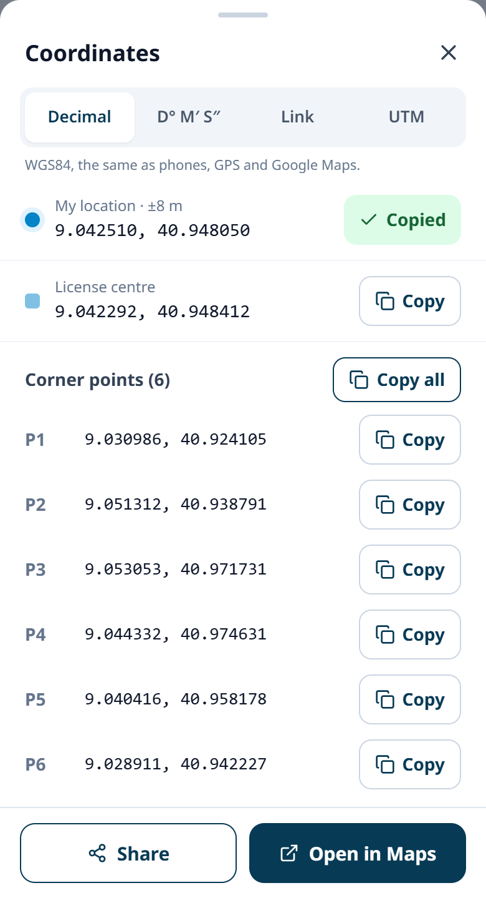

# Copying site coordinates

**Quick guide for field inspectors** · Ministry of Mines · የማዕድን ሚኒስቴር

Mining Field Monitoring System · November 2026

---

Use **Coordinates** to copy the exact position of a license area, its corner points or where you are standing, and paste it into Google Maps, a GPS device, WhatsApp, Telegram or a report.

## 1. Open the coordinates

1. Open **My Tasks** and tap the inspection.
2. Go to the **Site** tab, the map of the license area.
3. At the bottom, tap **Coordinates** (next to **Start inspection** / **Continue inspection**).

The **Coordinates** sheet opens from the bottom of the screen:

## 2. Choose the format

At the top of the sheet, tap the format you need. The system remembers your choice on your phone.

| Tap | You get | Use it for |
|---|---|---|
| **Decimal** | `9.030100, 38.746800` | Google Maps, WhatsApp, most apps |
| **D° M′ S″** | `9°01′48.4″N 38°44′48.5″E` | Reports, paper forms |
| **Link** | `https://www.google.com/maps?q=9.030100,38.746800` | Sending the place to a driver or colleague |
| **UTM** | `37N 472172 E 998190 N` | Handheld GPS devices |

## 3. Copy what you need

| Line | What it is |
|---|---|
| **My location** (±8 m) | Where your phone is now. Shown only when location is allowed for the site. |
| **License centre** | The middle of the license area. |
| **Corner points** P1, P2, P3 … | The corners of the license area, in order. |

- Tap **Copy** on a line. The button turns green and says **Copied**. Then paste it where you need it (press and hold → **Paste**).
- Tap **Copy all** to copy every corner point at once, one per line.

## 4. Share or open in maps

- **Share** sends the company, license number, centre, corner points and your location to WhatsApp, Telegram, SMS or another app, in the format you chose.
- **Open in Maps** opens the license centre in Google Maps, for directions.

Tap **✕** (or outside the sheet) to close it.

## Good to know

- The coordinates use **WGS84**, the same as phones, GPS devices and Google Maps.
- After you submit, **My location** becomes **Submitted from**: the place where you pressed Submit.
- **My location doesn't appear?** Allow location for the site: tap the lock icon next to the web address → **Permissions** → **Location** → **Allow**, then open the sheet again.
- **No corner points?** The license has no surveyed area in the system yet. Tell your supervisor.
- Copying works without internet. **Share** and **Open in Maps** need the other apps.
