

# Mining Field Monitoring System

## Field Inspector User Manual

**Ministry of Mines · የማዕድን ሚኒስቴር**

Mining Inspection Management System

Version 1.0 · November 2026

---

## Document information

| Item | Details |
|---|---|
| **Purpose** | To guide field inspectors, step by step, through everything they do in the Mining Field Monitoring System: signing in, finding their inspection tasks, filling in the MoM Mining Field Monitoring Checklist, attaching evidence, collecting signatures and submitting the inspection. |
| **Intended audience** | Field inspectors and team leaders of inspection teams. |
| **Not covered** | Administrator work (users, teams, schedules, checklists, reports) is not part of this manual. |
| **Screens shown** | Screenshots are taken from the system on a phone screen, which is how inspectors normally work in the field. On a computer the same pages are wider, but they work the same way. |
| **Privacy** | Names, phone numbers and email addresses of staff are blurred in the screenshots. The company in the examples was filled in with test answers only. |

---

## Table of contents

1. [Before you start](#1-before-you-start)
2. [Signing in](#2-signing-in)
3. [Getting around the system](#3-getting-around-the-system)
4. [Finding your inspection tasks (My Tasks)](#4-finding-your-inspection-tasks-my-tasks)
5. [Your companies and your team](#5-your-companies-and-your-team)
6. [Opening a task and checking the site](#6-opening-a-task-and-checking-the-site)
7. [Filling in the checklist](#7-filling-in-the-checklist)
8. [Saving your work](#8-saving-your-work)
9. [Checking and submitting the inspection](#9-checking-and-submitting-the-inspection)
10. [After submitting](#10-after-submitting)
11. [Troubleshooting](#11-troubleshooting)
12. [Checklist before you submit](#12-checklist-before-you-submit)
13. [List of figures](#13-list-of-figures)

---

## 1. Before you start

Make sure you have the following before going to the field:

| You need | Why |
|---|---|
| A smartphone with **Google Chrome** and **Location (GPS)** | You fill in the checklist on the phone, and the system records where you submit it. |
| An internet connection (mobile data or Wi-Fi) | Your answers and photos are saved to the server while you work. |
| Your **email address** and the **temporary password** given by your administrator | To sign in the first time. |
| The system address, starting with **https://** | Location only works on a secure (https) address. |

> **Note:** Questions of the checklist are shown in **Amharic**. Menus and buttons of the system are in English.

> **Tip:** Charge your phone fully and carry a power bank. Taking photos and using GPS uses the battery quickly.

---

## 2. Signing in

### 2.1 Sign in to the system

1. Open Chrome and go to the system address given by your administrator. The **Sign in** page opens (Figure 1).
2. In **Email** ①, type your email address.
3. In **Password** ②, type your password. Tap the eye icon if you want to see what you typed.
4. Tap **Log in** ③.

**What happens next:** the first time, the **Set your password** page opens (section 2.2). After that, you go straight to your **Dashboard** (section 3.1).

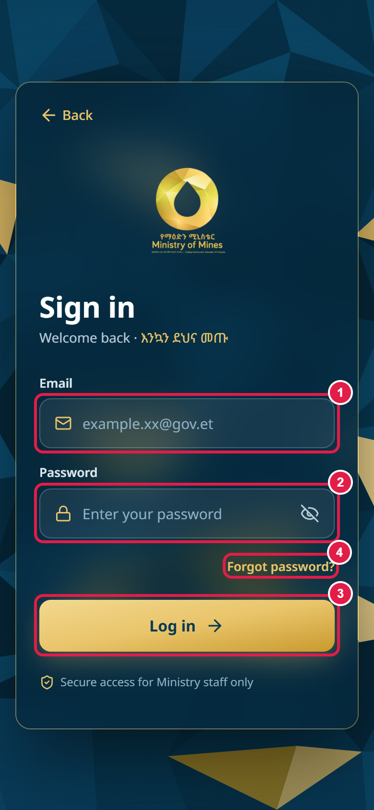

**Figure 1.** The Sign in page: ① Email, ② Password, ③ Log in, ④ Forgot password?

### 2.2 First sign-in: set your own password

The first time you sign in, you must replace the temporary password with your own.

1. In **New password** ①, type a new password of **at least 8 characters**.
2. In **Confirm new password** ②, type the same password again.
3. Tap **Update & log out** ③.

**What happens next:** you are logged out. Sign in again (section 2.1) with your email and your **new** password.

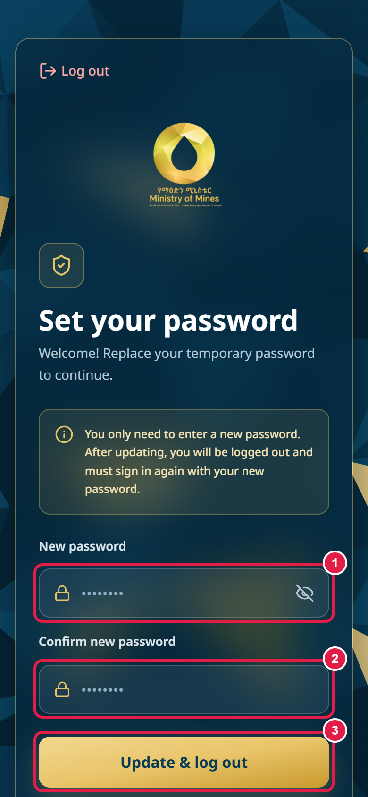

**Figure 2.** Setting your own password at the first sign-in.

> **Important:** Do not share your password. Every answer you save and every inspection you submit is recorded under your name.

### 2.3 If you forget your password

1. On the Sign in page, tap **Forgot password?** (④ in Figure 1).
2. Type your email address and tap **Send code**. A **6-digit code** is sent to your email.
3. Type the code and tap **Verify code**. If no email arrives, check the spam folder or tap **Resend**.
4. Type a new password (at least 8 characters) twice and tap **Reset password**.
5. Sign in with the new password.

---

## 3. Getting around the system

### 3.1 The Dashboard

After signing in, the **Dashboard** opens. It shows how your team is doing (Figure 3):

- **Team · this month** ② and **Team · all time**: inspections submitted out of all tasks, how many were on time, and how many are overdue now.
- **Me**: the inspections you submitted yourself, late submissions, and inspections returned to you for correction.
- **Team submissions per week** and **Recent submissions**.

> **Note:** The checklist does not give a score, so the Dashboard shows no scores.

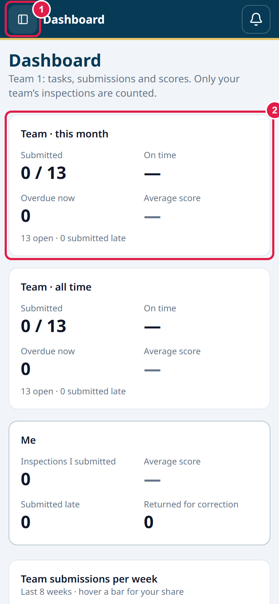

**Figure 3.** The Dashboard: ① the menu button, ② your team's progress this month.

### 3.2 The menu

Tap the **menu button** (① in Figure 3) at the top left to open the menu (Figure 4). On a computer, the menu is always shown on the left.

| Menu item | What it is for |
|---|---|
| ① **Dashboard** | Your team's progress (section 3.1). |
| ② **My Tasks** | The inspections your team must do. **This is where you start your work.** |
| ③ **My Team** | The members of your team and their contacts. |
| ④ **My Companies** | The companies and license areas of your team, on a map or as a list. |

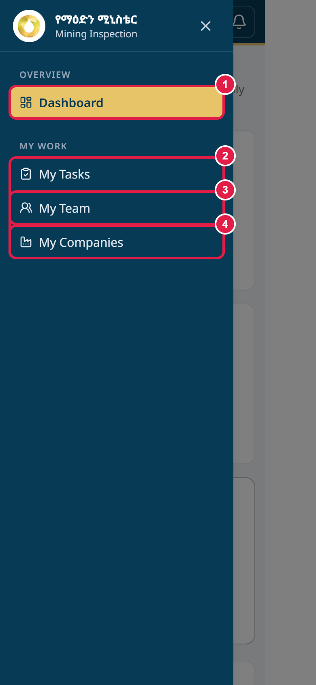

**Figure 4.** The menu of an inspector.

The bell icon at the top right shows your notifications.

---

## 4. Finding your inspection tasks (My Tasks)

Open **My Tasks** from the menu. Each card is one inspection of one license that your team must do (Figure 5).

At the top you see your team and how many tasks are submitted (for example **0 / 13**). Below it:

| Control | How to use it |
|---|---|
| ① **Status tabs** | **All open** (everything not yet submitted), **Not started**, **In progress**, **Returned** (sent back to you for correction), **Overdue**, **Submitted**. Swipe left to see all tabs. The number on each tab is how many tasks it has. |
| ② **Search** | Type a company name, license number, checklist or area. |
| ③ **Checklist** | Show the tasks of one checklist only, or **All checklists**. |
| ④ **Group by** | Group the cards by **Checklist** (default), **Company**, **Due date** or **Region**. The button with sliders next to it has more filters (license type, region, sort order). |

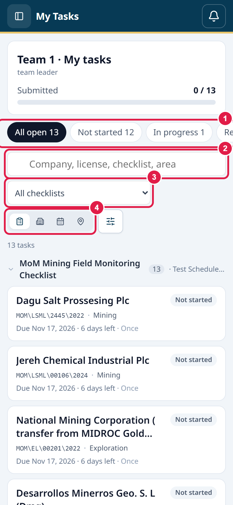

**Figure 5.** My Tasks: ① status tabs, ② search, ③ checklist filter, ④ group by.

### 4.1 Reading a task card

Each card (① in Figure 6) shows the company name, the license number and type (Mining or Exploration), and the due date with the days left. The label at the top right ② shows the status:

| Label | Meaning |
|---|---|
| **Not started** | Nobody in your team has opened and saved this inspection yet. |
| **In progress 40%** | Answers are saved; the percentage shows how much is answered. A bar under the card shows the same. |
| **Returned** | A supervisor sent it back for correction. Open it, correct it and submit again. |
| **Overdue** | The due date has passed and it is not submitted. A red line shows how many days late it is. |
| **Submitted** / **Submitted late** | It is done. |

Tap a card to open the task.

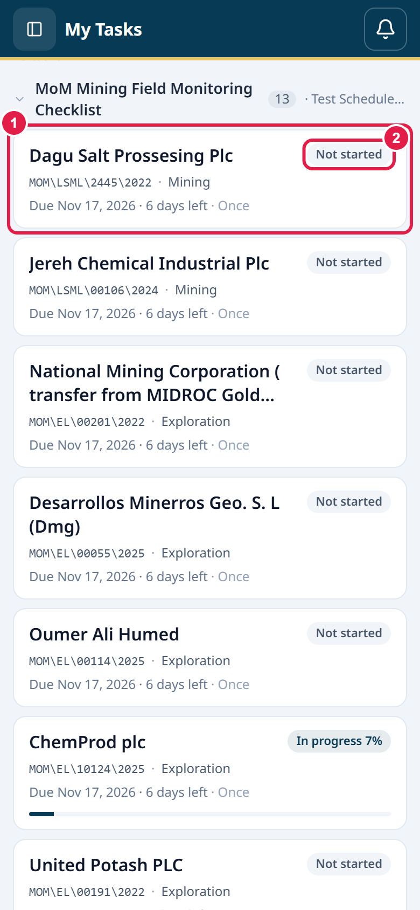

**Figure 6.** A task card: ① the card (tap to open), ② its status.

---

## 5. Your companies and your team

### 5.1 My Companies: the license areas on a map

**My Companies** shows every license of your team. Use it to plan your trip and to check where the license areas are.

1. Tap **Choose a license** ① to pick a company from the list (Figure 7).
2. The map zooms to the license area. The card at the bottom tells you whether you are inside the area, when the next task is due, and how to travel there (for example **By plane via DireDawa**).
3. Tap **Open task** ③ to open the inspection of this license (Figure 8).

Other buttons on the map:

- **Show my position** (② in Figure 7): moves the map to where you are (blue dot).
- **Full page** (③ in Figure 7): shows the map on the whole screen. Tap it again, or press Esc on a computer, to go back.
- **Show all licenses** (② in Figure 8): zooms out to all your licenses.
- **List**: shows the same companies as a list instead of a map.

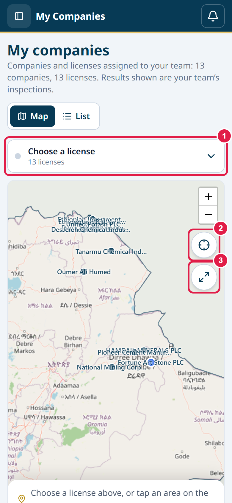

**Figure 7.** My Companies: ① choose a license, ② show my position, ③ full page map.

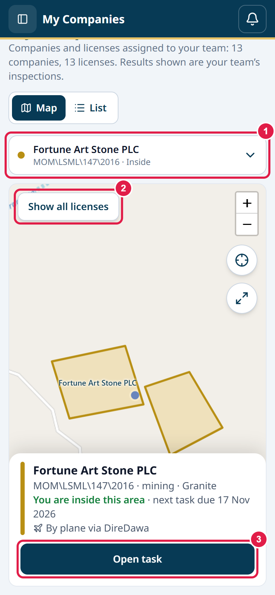

**Figure 8.** A chosen license: ① the chosen license, ② show all licenses, ③ open its task.

### 5.2 My Team

**My Team** lists the members of your team with their phone numbers and email addresses, so you can contact each other in the field (Figure 9). Every team member is a **Team leader**: any member can fill in and submit the team's inspections.

> **Note:** You can change your own details on your profile. Changes to the team are made by an administrator.

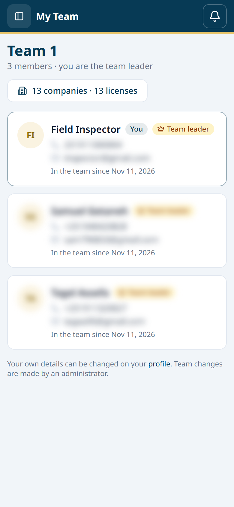

**Figure 9.** My Team (other members' names and contacts are blurred in this manual).

---

## 6. Opening a task and checking the site

When you open a task, its page shows the company, the license number and type, the checklist, and the due date. The page has three tabs (① in Figure 10):

| Tab | What it shows |
|---|---|
| **Site** | The license area on a map and where you are. |
| **Questions** | The checklist to fill in. |
| **History** | What has happened to this task (started, submitted, returned …). |

### 6.1 The Site tab

A task that is not started yet opens on the **Site** tab (Figure 10).

1. When the browser asks to use your location, tap **Allow**.
2. Look at the label ② at the top of the map:
   - **Inside the license area** (green): you are at the site.
   - **"2.4 km outside the area"** (orange): the panel below tells you which direction to go.
3. Use **Centre on my position** ③ to move the map to you, and **Full page** ④ to see the map on the whole screen.
4. When you are ready, tap **Start inspection** ⑤. The **Questions** tab opens.

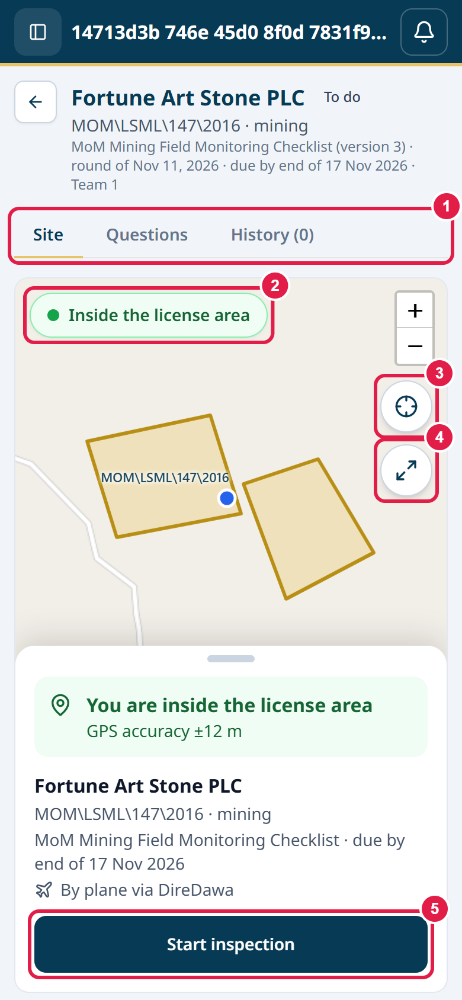

**Figure 10.** The Site tab: ① tabs, ② your position against the license area, ③ centre on my position, ④ full page map, ⑤ Start inspection.

> **Note:** You can fill in the checklist even when you are outside the area. The system only records where you were when you submitted; it does not stop you.

---

## 7. Filling in the checklist

### 7.1 How the checklist page works

The **Questions** tab shows the checklist one **section** at a time (Figure 11).

- At the top you see the company name and the **section you are in** (for example *2. የኩባንያና የሥራ ቦታ መረጃ*).
- ① **Sections** opens the list of all sections (Figure 12).
- ② The **save button** shows whether your answers are saved (see section 8).
- ③ The **progress bar** has one segment per section. The current section is gold, completed sections are dark blue. On the right it says, for example, **Section 1 of 11**.
- At the bottom, **Previous** and **Next** move between sections. On the last section, **Next** becomes **Check and submit**.

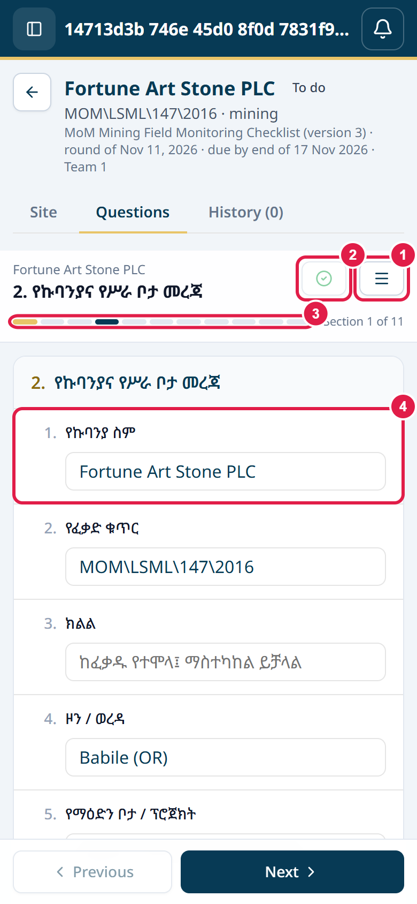

**Figure 11.** The checklist: ① Sections, ② save status, ③ progress, ④ an answer already filled in from the license.

#### The Sections list

Tap **Sections** to see every section with how many questions are answered and how many are **left** (Figure 12). Tap a section to go to it. A green tick means the section is complete.

At the top of the list ① you can choose how to see the checklist:

- **By section**: all the questions of a section on one page (default).
- **One question at a time**: one question per screen with large buttons (Figure 13). This is easier on a small phone.

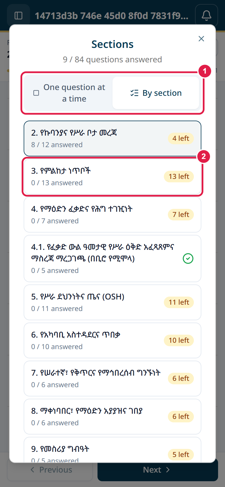

**Figure 12.** The Sections list: ① layout choice, ② a section with the number of questions left.

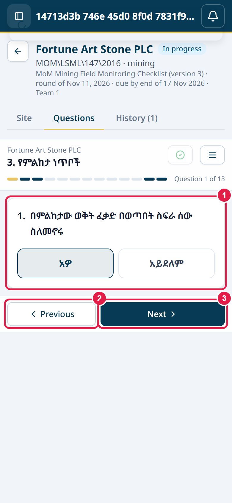

**Figure 13.** One question at a time: ① the question with its answer buttons, ② Previous, ③ Next.

### 7.2 Questions for exploration and mining licenses

The checklist shows **every question** for both exploration and mining licenses. Some questions are mostly about mining work, for example production, stockpiles, dispatch and sales records (section 3), the license document at the site (section 4), and rehabilitation and mine closure (section 6).

**Skip the questions that do not apply** to the license you are inspecting. You do not need to choose the license type: it is shown at the top of the task (for example *mining* or *exploration*).

> **Important:** **No question is mandatory.** Answer every question you can. Before you submit, the system shows you which questions are still empty (section 9.1).

### 7.3 Section 2: company and site information

Many answers in section 2 are **filled in for you** from the license: company name (④ in Figure 11), license number, region, zone/woreda, main mineral, the Ministry representatives (your team) and the company's focal person.

1. Check each pre-filled answer. If something is wrong, tap it and correct it.
2. Fill in the empty questions, for example the **mining method** ①, the **unit of measure** ② and the **date of the field observation** ③ (Figure 14). For the date, tap the field and pick the date.
3. A field that is still empty shows the hint *ከፈቃዱ የተሞላ፤ ማስተካከል ይቻላል* ("filled from the license; can be corrected") when the license had no value for it.

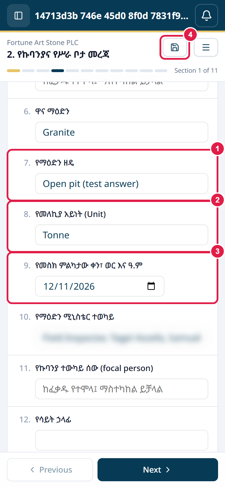

**Figure 14.** Section 2 being filled in: ①–③ answers typed by the inspector, ④ the save button showing there are unsaved changes.

### 7.4 Yes / No questions

Most questions of section 3 are answered **አዎ (Yes)** or **አይደለም (No)** (① in Figure 15).

1. Tap **አዎ** or **አይደለም**. The chosen answer is highlighted.
2. To change it, tap the other answer.
3. To clear an answer, tap the highlighted answer again.

### 7.5 Text questions

Other questions have a **text box** (② in Figure 15). Tap the box and write your observation in your own words. The box has room for several lines and scrolls when you write more; on a computer you can drag its bottom-right corner to make it bigger.

Write facts you saw on the site: what work is going on, quantities, dates, names of documents you checked, and the problems found.

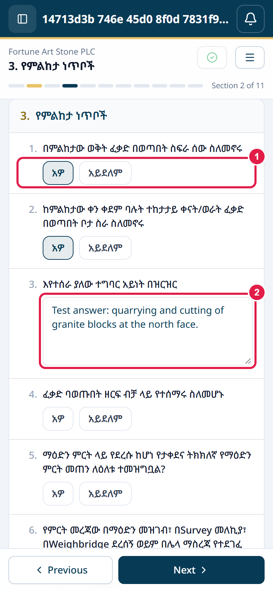

**Figure 15.** Section 3: ① a Yes / No question, ② a text question.

### 7.6 Attaching photos, documents and videos

Some questions take files, for example the attachments for question 12 of section 3 (Figure 16) and the evidence question of section 10 (Figure 17).

1. Tap the box with the **+** sign (③ in Figure 16).
2. Your phone offers to take a **photo** or **video** with the camera, or to choose a file. Choose what you need.
3. Wait until the file has finished uploading. A progress bar shows while it uploads. The file then appears as a tile ②.
4. To remove a file, tap the **×** on its tile, then tap again to confirm.

What you can attach:

| Kind | File types | Limits |
|---|---|---|
| Photos | JPEG, PNG, WebP, HEIC | Up to **20 files** per question, up to **20 MB** each. The number of files already added is shown, for example **1/20**. |
| Documents | PDF, Word, Excel, PowerPoint, CSV, text | |
| Videos | MP4, MOV, WebM, 3GP, MKV | |

> **Tip:** Large phone photos are made smaller automatically before they are uploaded, so they upload faster and still stay clear.

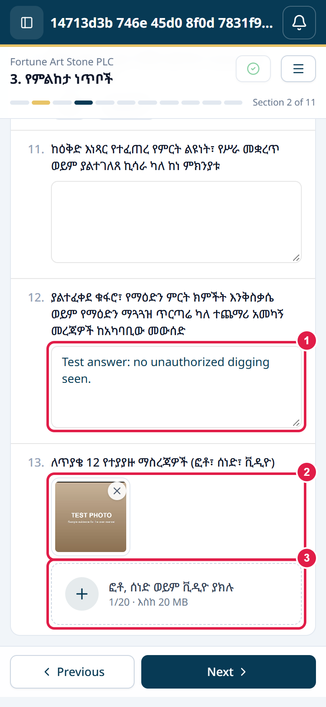

**Figure 16.** Section 3, question 12 and its attachments: ① the text answer, ② an attached photo, ③ add more files.

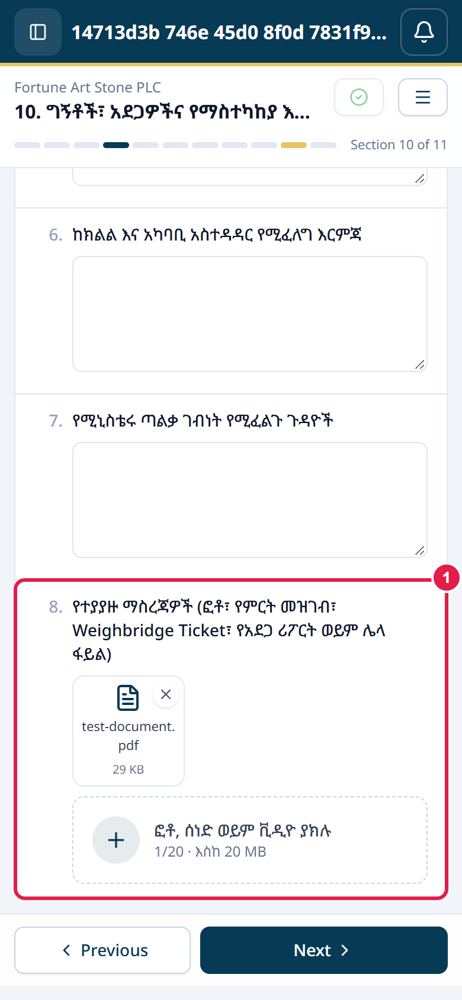

**Figure 17.** Section 10: the evidence question accepts any file: photos, production records, weighbridge tickets, incident reports or other documents.

### 7.7 Sections 4 to 10

Sections 4 to 10 are text questions about the license and legal compliance (4), occupational safety and health (5), the environment (6), labour, employment and community relations (7), processing, mineral handling and marketing (8), equipment and infrastructure (9), and findings, risks and corrective actions (10).

Write a short, clear description for each question. In section 10, summarise the overall situation of the company, the actions expected from the company, the actions needed from the regional and local administration, and the issues that need the Ministry's intervention. Attach the evidence in the last question of section 10.

### 7.8 Section 4.1: filled in at the office

Section 4.1 (the license contract's annual work plan) is **optional** and is **filled in at the office** after you return from the field. You can leave it empty in the field.

- Section 4.1 is not counted in the check before submitting.
- After the inspection is submitted, your team can still open it and fill in section 4.1. All other sections stay locked.

### 7.9 Section 16: signatures

Section 16 is a signature table with the columns **Role type**, **Full name**, **Signature** and **Date** (Figure 18). It has:

- one row for each **team member**, with their names already filled in;
- a row for the **company lead**;
- rows for the **people interviewed**.

> **On a phone, the table is wider than the screen.** Swipe the table to the left to see the **Signature** and **Date** columns.

**To sign by drawing:**

1. In the row of the person signing, tap **Sign** (① in Figure 18). A signature pad opens (Figure 19).
2. The person draws the signature with a finger in the box ①.
3. Tap **Save signature** ②. Tap **Clear** ③ to start again, or **Cancel** to close without saving.
4. The signature appears in the row, and **today's date is filled in** automatically (Figure 20). You can change the date if needed.

**To use a photo of a signature** (for example a signature on paper): tap the picture button next to **Sign** (② in Figure 18) and take or choose a photo. It must be under 2 MB after it is made smaller; take it as a normal JPEG photo.

**Other actions in the table:**

- Write the person's name in **Full name** for the company lead and each person interviewed.
- To add another person interviewed, tap **Add ቃለ መጠይቅ የተደረገለት ሰው** under the table. A new numbered row is added.
- To remove a signature, tap the **×** next to it. To remove a whole row, tap the bin icon at the end of the row.

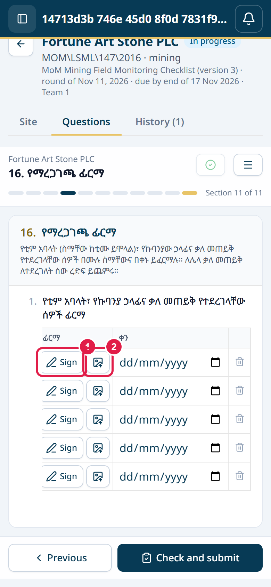

**Figure 18.** Section 16, swiped to the left: ① Sign, ② use a photo of the signature.

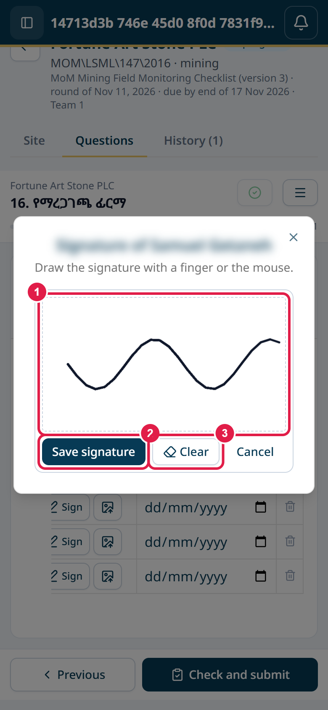

**Figure 19.** The signature pad: ① draw here, ② Save signature, ③ Clear.

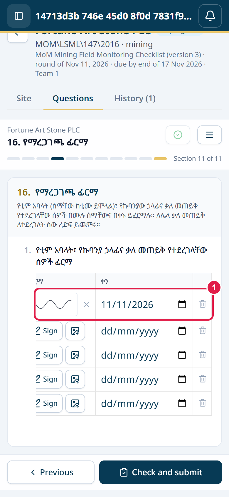

**Figure 20.** ① A signed row: the signature and today's date are filled in.

---

## 8. Saving your work

**Your answers are saved automatically** about 3 seconds after you stop typing, and every time you move to another section. You do not need to press anything.

The save button at the top of the checklist (② in Figure 11, ④ in Figure 14) shows the state:

| Button shows | Meaning | What to do |
|---|---|---|
| Green tick (**Saved**) | Everything is saved. | Nothing. |
| Disk icon (**Save**) | Your latest changes are not saved yet. | Wait a moment, or tap it to save now. |
| Turning circle | Saving… | Wait. |
| Disk icon that does not turn into a tick | The phone could not reach the server. | Check your connection; your answers stay on the screen. Tap the disk icon again when you are back online. |

On a computer, words are also shown next to the button: **All changes saved**, **Unsaved changes**, **Saving…**, or **Not saved — check your internet** when the connection failed.

> **Warning:** Do not close the page while there are unsaved changes. If you try, the browser warns you. Wait for the green tick first.

> **Tip:** Your team shares the same inspection. If a teammate saved changes while you were working, you see the message *"[Name] saved changes to this inspection. Reload it to see their answers before you continue."* Tap **Reload**, check their answers, and continue. Agree within the team who fills in which section, so you do not overwrite each other.

The page also remembers where you were. When you come back to the task, it opens at the same section.

---

## 9. Checking and submitting the inspection

### 9.1 Check what is not filled in

1. Go to the last section and tap **Check and submit** (or tap **Sections**, then **Check and submit**).
2. The **Check before submitting** window opens (Figure 21). It shows:
   - how many questions are filled in, for example **20 of 84 questions filled in**;
   - ① how many questions are **not filled in**. They are not mandatory, but you are told about them;
   - ② the list of these questions by section, with what is missing (**Not answered**, **No file added**, **1 row not signed** …).
3. Tap a question in the list to go straight to it, or tap **Fill them in** ③ to go to the first one.
4. When you are ready, tap **Submit anyway** ④ (or **Submit inspection** when everything is filled in).

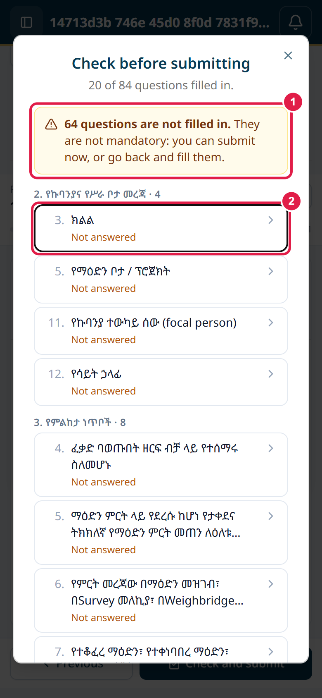

**Figure 21.** Check before submitting: ① questions not filled in, ② go to a question, ③ Fill them in, ④ Submit anyway.

### 9.2 Share your location

The Ministry records **where** each inspection is submitted. Your location is taken once, at the moment you submit, and saved with this inspection only.

- If you allowed location for this site before, the system takes your location without asking and submits at once.
- Otherwise, the **Share your location to submit** screen opens (Figure 22):
  1. Turn on the phone's **Location** in the quick settings.
  2. Tap **Allow location** ①, then **Allow** when the phone asks.
  3. The system finds your location and submits the inspection.
- Tap **Back to the questions** ② to go back without submitting.

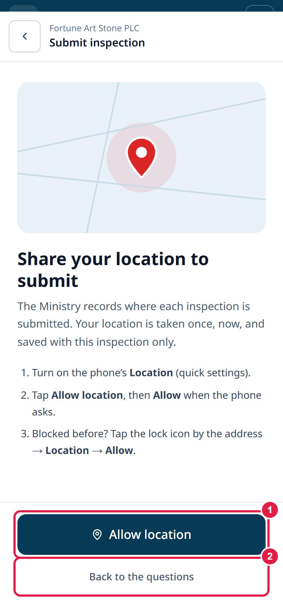

**Figure 22.** Sharing your location to submit: ① Allow location, ② Back to the questions.

> **Important:** You cannot submit without your location. If location is blocked, see section 11.

---

## 10. After submitting

- The message **"Submitted. Thank you."** appears. After the due date it says **"Submitted (late). Thank you."**
- The task moves to the **Submitted** tab of My Tasks, and its status becomes **Submitted**.
- The answers are **locked**. Nobody in the team can change them.
- **Section 4.1 stays open** for your team: a blue message on the task says it is *filled in at the office* and can still be completed. Tap **Open it**, fill in section 4.1, and your changes are saved as you type.
- The **History** tab (Figure 23) lists what happened to the task: started, submitted, completed at the office, and so on, with the date and the person.

### If an inspection is returned for correction

A supervisor can send a submitted inspection back to your team. It then appears under **Returned** in My Tasks.

1. Open the task. A purple message at the top shows **who returned it, when, and why**.
2. Correct the answers as asked.
3. Submit again (section 9).

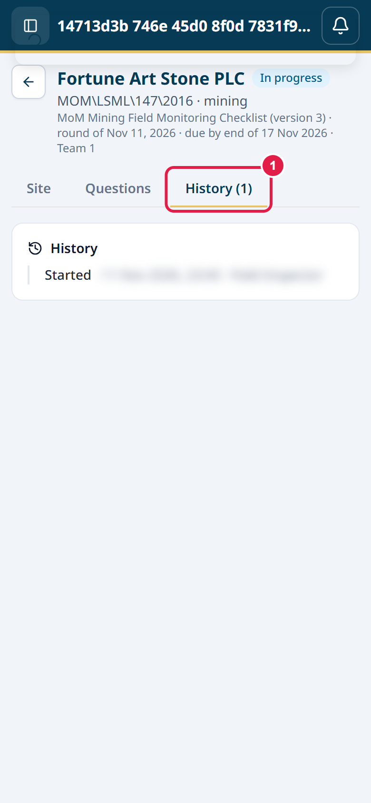

**Figure 23.** ① The History tab of a task.

---

## 11. Troubleshooting

| Problem or message | What to do |
|---|---|
| **Cannot sign in** | Check the email address and password (passwords are case-sensitive). Use **Forgot password?** (section 2.3). If it still fails, contact your administrator. |
| **"Password must be at least 8 characters"** / **"Passwords don't match"** | Type a longer password, and type exactly the same password in both fields. |
| **"Invalid or expired OTP"** | The code is wrong or too old. Tap **Resend** and use the new code from your email. |
| **No tasks in My Tasks** / *"You are not in an inspection team yet"* | Ask your administrator to add you to a team. New tasks appear when a schedule starts a new round. |
| **The save button stays a disk icon** (on a computer: *"Not saved — check your internet"*) | Move to a place with network coverage, then tap the disk icon. Do not close the page before the green tick appears. |
| **"[Name] saved changes to this inspection. Reload it …"** | A teammate saved the same inspection. Tap **Reload**, check their answers, then continue. |
| **A file does not upload: "Upload failed. Check your internet connection."** | Check your connection and add the file again. |
| **"The file is too large"** or *"… the limit here is 20 MB"* | Use a smaller file, a shorter video, or a lower camera resolution. |
| **"… this question takes photos only"** (or another file kind) | That question accepts only the kinds of file listed in its box. |
| **Signature photo: "a signature photo can be at most 2 MB"** | Take the photo again as a normal JPEG photo, or draw the signature instead. |
| **"Location is blocked for this site"** | Tap the lock icon next to the address → **Permissions** (or Site settings) → **Location** → **Allow**, then tap **Try again**. |
| **"Finding your location took too long"** | Make sure the phone's Location is on, move to an open area or near a window, and try again. |
| **"Your location could not be found"** | Turn on the phone's Location (GPS) in the quick settings and try again. |
| **"This browser has no location service"** | Open the system in **Chrome** on a phone with GPS. |
| **"This page is not secure (http://)"** | Open the system at its **https://** address. Browsers only share the location on https pages. |
| **The Site tab says "Location is turned off for this site"** | Allow location for the site (see "Location is blocked" above). |
| **The map shows "No surveyed area for this license"** | The license has no surveyed area in the system yet. You can still fill in and submit the checklist. |
| **I cannot see the Signature column in section 16** | Swipe the table to the left (section 7.9). |
| **"Only members of [team] can fill this inspection."** | The task belongs to another team. Check that you opened the right task. |
| **"This inspection has been submitted and can't be changed."** | It is already submitted. Only section 4.1 can still be completed (section 10). |

---

## 12. Checklist before you submit

Use this list before you tap **Submit**:

- [ ] I am at the site, or I know the location will be recorded where I am now.
- [ ] Section 2: the company and site details are correct; the observation date is filled in.
- [ ] Every Yes / No question that applies is answered.
- [ ] Every text question has a clear, factual description of what I saw.
- [ ] Photos and documents are attached where evidence is needed, and all uploads have finished.
- [ ] Section 10: the overall situation, the actions expected and the issues for the Ministry are written, and the evidence is attached.
- [ ] Section 16: every team member, the company lead and each person interviewed has signed, with their full name and the date.
- [ ] **Check and submit** shows no question that I forgot to fill in.
- [ ] The save button shows the green tick (everything is saved).
- [ ] The phone's Location is on.
- [ ] Section 4.1 will be completed at the office after returning.

---

## 13. List of figures

| Figure | Title | Section |
|---|---|---|
| 1 | The Sign in page | 2.1 |
| 2 | Setting your own password at the first sign-in | 2.2 |
| 3 | The Dashboard | 3.1 |
| 4 | The menu of an inspector | 3.2 |
| 5 | My Tasks | 4 |
| 6 | A task card | 4.1 |
| 7 | My Companies | 5.1 |
| 8 | A chosen license on the map | 5.1 |
| 9 | My Team | 5.2 |
| 10 | The Site tab | 6.1 |
| 11 | The checklist page | 7.1 |
| 12 | The Sections list | 7.1 |
| 13 | One question at a time | 7.1 |
| 14 | Section 2 being filled in | 7.3 |
| 15 | Section 3: Yes / No and text questions | 7.4–7.5 |
| 16 | Section 3, question 12 and its attachments | 7.6 |
| 17 | Section 10: the evidence question | 7.6 |
| 18 | Section 16: the signature table | 7.9 |
| 19 | The signature pad | 7.9 |
| 20 | A signed row | 7.9 |
| 21 | Check before submitting | 9.1 |
| 22 | Sharing your location to submit | 9.2 |
| 23 | The History tab | 10 |

---

*Ministry of Mines · Mining Field Monitoring System · Field Inspector User Manual · Version 1.0 · November 2026*

